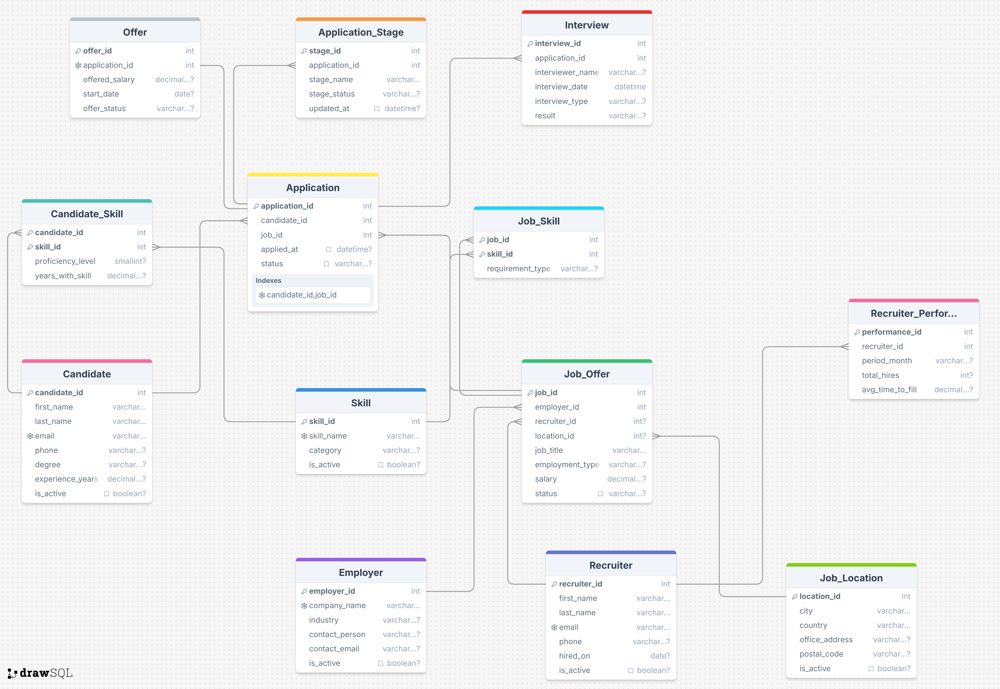
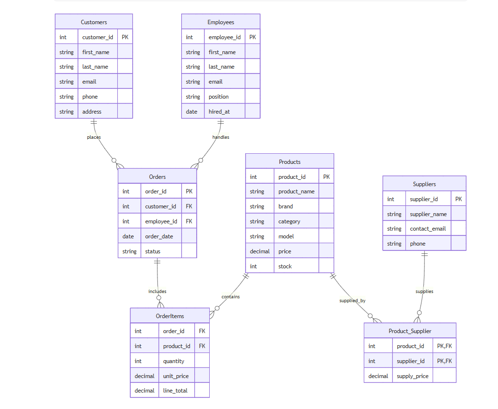
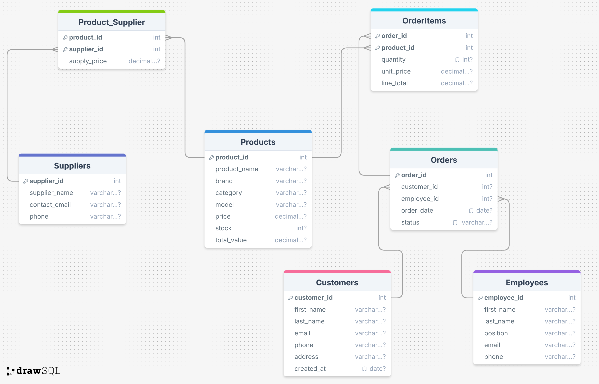

# SQL Portfolio — PostgreSQL

SQL work completed during EPAM's *Data Analytics Engineering Fundamentals* program (Oct–Dec 2025). The work covers database design, data loading, PL/pgSQL, analytical queries and access control. Both database build scripts run end to end on a clean PostgreSQL 16 database.

| # | Project | Files |
|---|---|---|
| 1 | [Recruitment agency database](#1-recruitment-agency-database) | [`recruitment_agency.sql`](recruitment_agency.sql) · [ER diagram](er_diagram.png) · [business description](recruitment_business_description.pdf) |
| 2 | [Household appliance store database](#2-household-appliance-store-database) | [`appliance_store.sql`](appliance_store.sql) · [conceptual](conceptual_model.png) / [logical](logical_model.png) models · [business description](store_business_description.pdf) |
| 3 | [Sales analytics with window functions](#3-sales-analytics-with-window-functions) | [`window_functions.sql`](window_functions.sql) · [`window_frames.sql`](window_frames.sql) |
| 4 | [Access control & row-level security](#4-access-control--row-level-security) | [`roles_and_rls.sql`](roles_and_rls.sql) · [`security_audit.sql`](security_audit.sql) · [`security_questions.md`](security_questions.md) |

**Skills:** PostgreSQL · DDL / DML / DCL / TCL · normalization (3NF) · ER modelling · CTEs · window functions & frames · `FILTER` · PL/pgSQL · views · roles & RLS

---

## 1. Recruitment agency database

**Problem:** A recruiting agency tracks candidates, employers, job offers, applications, interviews and offers in scattered records. That leads to duplicates, lost data, and no clear view of which candidates fit which jobs or how recruiters perform.

**Solution:** A normalised (3NF) database in the `recruit_core` schema with **13 tables**.

| Relationship | Type |
|---|---|
| Employer → Job_Offer · Recruiter → Job_Offer · Job_Location → Job_Offer | 1:M |
| Candidate → Application ← Job_Offer | 1:M each |
| Application → Application_Stage / Interview | 1:M |
| Application → Offer | 1:1 |
| Recruiter → Recruiter_Performance | 1:M (monthly) |
| Candidate ↔ Skill (via Candidate_Skill) · Job_Offer ↔ Skill (via Job_Skill) | M:N |

- **Integrity:** identity primary keys, composite keys on junction tables, `UNIQUE` emails and company names, `CHECK` rules (for example, experience ≥ 0, proficiency between 1 and 5), `NOT NULL` with defaults.
- **Seed data:** inserts look up foreign keys by natural keys (email, skill name) instead of hard-coded IDs, and use `ON CONFLICT DO NOTHING`, so the script can be re-run safely.
- **Audit column:** a `record_ts` column is added to every table with `ALTER TABLE`.

## 2. Household appliance store database

**Problem:** A retail appliance store keeps customers, orders, stock and suppliers in manual, partial records, with no access control.

**Solution:** A database in the `store` schema with **7 tables**: Customers, Employees, Suppliers, Products, Orders, OrderItems (Orders ↔ Products), Product_Supplier (Products ↔ Suppliers). It was designed from a conceptual model to a logical model and then implemented.

| Conceptual model | Logical model |
|---|---|
|  |  |

- **Constraints:** unique emails, non-negative price and stock, allowed order statuses, and order dates after 2024-01-01.
- **PL/pgSQL functions:**
  - `update_product_column()` updates only whitelisted columns, using dynamic SQL with `FORMAT(%I, %L)` to prevent injection.
  - `add_order(email)` creates an order from a customer's email and raises an error if the customer doesn't exist.
- **View:** `recent_quarter_analytics` shows customer, product, quantity and revenue for the latest quarter with sales.
- **Security:** a `manager` role with read access to all current and future tables in the schema.

## 3. Sales analytics with window functions

Business questions answered on the Oracle **SH (Sales History)** sample schema.

| Question | Techniques |
|---|---|
| Who are the top 5 customers per channel, and what is each one's share of channel sales? | CTE, `SUM(SUM()) OVER (PARTITION BY)`, `DENSE_RANK()` |
| Which customers were in the top 300 of their channel in each of 1998, 1999 and 2001? | `DENSE_RANK()` per channel-year, `HAVING COUNT(DISTINCT year) = 3` |
| How did Europe and the Americas compare by category in Q1 2000? | Conditional aggregation with `FILTER (WHERE …)` |
| How did each channel's share of regional sales change year over year? | % of total, `LAG()`, `NULLIF` |
| What were the cumulative weekly sales and centred 3-day averages? | `ROWS BETWEEN …` frames |
| How do the three frame types differ? | `ROWS` vs `RANGE` vs `GROUPS` |

## 4. Access control & row-level security

Security work on the `dvd_rental` sample database.

- **Audit:** reviews existing roles, memberships, table ownership and privileges (`pg_roles`, `pg_auth_members`, `pg_tables`, `information_schema`).
- **Least privilege:** a login user with read access to customers and a `rental` group role; `INSERT` is granted and then revoked, and the denied action is demonstrated.
- **Row-level security:** a PL/pgSQL function creates a personal login role for any customer, and policies on `rental` and `payment` make each customer see only their own rows.
- **Theory:** written answers on column-level restriction via views, identification vs authentication, PostgreSQL authentication methods and proxy authentication.

> Passwords in these scripts are placeholders for a local training database.

---

**How to run (projects 1–2):** `CREATE DATABASE recruit_agency;` (or `retail_store`), connect to it, then run the `.sql` file.
